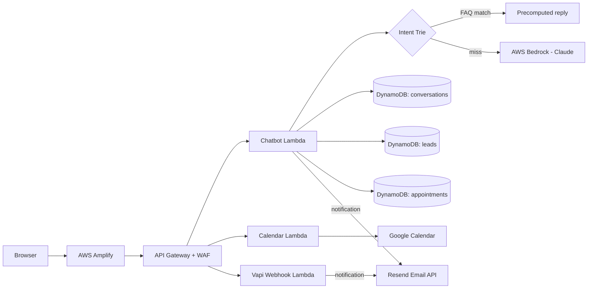

# Unkommon

Growth agency for small and mid-sized businesses. Websites and apps, search
and AI-search visibility, and automation, built and operated by one team.


**Live:** [www.unkommon.ai](https://www.unkommon.ai)

## Architecture

```
Browser
  |
  |-- React SPA, prerendered per route (AWS Amplify)
  |     |-- AI Chatbot with tool-calling
  |     +-- Calendar booking integration
  |
  +-- API Gateway (WAF rate-limited)
        |-- POST /api/chat ----------- Intent Trie fast-path, else Claude on Bedrock
        |-- GET  /api/calendar/availability  Google Calendar API
        |-- POST /api/calendar/book ----------- Google Calendar API
        +-- POST /api/vapi-webhook --- HMAC-verified voice webhooks
```



## Features

**AI Chatbot.** Conversational assistant powered by Claude on AWS Bedrock. Multi-turn conversations with DynamoDB persistence (24 hour TTL) and tool-calling for calendar availability checks and appointment booking. Includes server-side prompt injection detection and a global hourly request budget to cap Bedrock costs.

**Intent classifier (Trie fast-path).** A Trie (prefix tree) runs before the Bedrock call and answers common FAQ questions from precomputed responses in O(m) time, where m is the number of words in the message. Only messages that do not match fall through to the language model, which cuts latency and per-token cost for common questions and keeps those answers deterministic.

**Prerendered routes for AI crawlers.** Vite emits a single `index.html` for the
SPA, so every URL would otherwise serve identical HTML: the same title, the same
canonical, and the same content. Googlebot executes JavaScript and recovers;
GPTBot, ClaudeBot and PerplexityBot do not, so to them every page would look like
the homepage. A post-build step writes one HTML file per route with correct head
tags, route-specific fallback content, and per-page JSON-LD, then regenerates
`sitemap.xml` and `llms.txt`. It fails the build if a substitution does not
match, so template changes surface as errors rather than silently wrong output.

**Lead and appointment persistence.** Captured leads and booked appointments are stored in DynamoDB with Global Secondary Indexes for the access patterns the business needs: recent leads by date, appointments by customer, and appointments by date range.

**Calendar Integration.** Google Calendar API with service account domain-wide delegation. Checks real-time availability, books appointments with conflict detection, generates Google Meet links, and sends branded HTML confirmation emails via Resend.

**Voice Webhook Processing.** Inbound voice call webhook handler with HMAC signature verification (fail-closed). Extracts structured data from Vapi call reports (name, email, phone) and triggers lead notification emails to the sales team via Resend.

## Tech Stack

| Frontend | Backend | Infrastructure |
|----------|---------|----------------|
| React 18 + TypeScript | Python 3.13 | AWS SAM (IaC) |
| Vite | AWS Lambda (3 functions) | API Gateway + WAFv2 |
| Tailwind CSS | AWS Bedrock (Claude) | DynamoDB (3 tables) |
| Framer Motion | Google Calendar API | AWS Secrets Manager |
| Radix UI / shadcn | Resend (email) | AWS Amplify (hosting) |
| Wouter (routing) | boto3 / requests | pytest + GitHub Actions CI |

## Project Structure

```
.
├── frontend/                React SPA, prerendered at build time
│   ├── src/
│   │   ├── components/      UI components (ChatWidget, CTAButton, diagrams)
│   │   ├── pages/           Route pages (home, services, about, etc.)
│   │   ├── data/            services.ts (catalogue), seo.ts (route metadata)
│   │   ├── hooks/           Custom hooks
│   │   └── lib/             Utilities, useSeo head manager
│   ├── scripts/
│   │   └── prerender.mjs    Post-build: per-route HTML, sitemap.xml, llms.txt
│   ├── public/              Static assets
│   └── package.json
│
├── backend/                 AWS SAM serverless API
│   ├── chatbot/             AI chatbot (layered architecture)
│   │   ├── app.py           Lambda entry shim
│   │   ├── handlers/        HTTP handler + request guards
│   │   ├── services/        chat_service (tool-calling loop + Trie fast-path)
│   │   ├── domain/          system_prompt, tools, intent_trie (FAQ Trie)
│   │   ├── data/            DynamoDB, Bedrock, calendar, email, leads, appointments wrappers
│   │   ├── tests/           pytest suite (mocked AWS dependencies)
│   │   └── benchmark_intent_trie.py   Trie performance benchmark
│   ├── calendar_api/        Google Calendar integration
│   ├── vapi_webhook/        Voice webhook processor (HMAC-verified)
│   ├── events/              Sample invocation events
│   └── template.yaml        SAM infrastructure definition
│
├── .github/workflows/       GitHub Actions CI (runs the chatbot tests)
├── amplify.yml              Amplify build config
└── LICENSE
```

## Testing

- **pytest** suite for the chatbot, with every external dependency (Bedrock, DynamoDB, calendar, email) mocked, so tests run fast and offline.
- **GitHub Actions** runs the test suite on every push.

## Getting Started

### Prerequisites

- Node.js 18+
- Python 3.13
- AWS SAM CLI
- AWS account with Bedrock access (Claude model access enabled)

### Frontend

```bash
cd frontend
cp .env.example .env       # Fill in your API URLs and keys
npm install
npm run dev                # Dev server on :3000
npm run build              # vite build, then scripts/prerender.mjs
```

`npm run build` runs the prerender step after Vite. Running `vite build` on its
own produces a single `index.html` for every route, which breaks canonical tags
and leaves AI crawlers seeing the homepage at every URL.

### Backend

```bash
cd backend
sam build
sam deploy --guided        # First deploy (creates resources + prompts for parameters)
```

Required SAM parameters: `VapiWebhookSecret`, `ResendApiKey`, `LeadsNotificationEmail`.

### Tests

```bash
cd backend/chatbot
python -m pytest -q
```

## Security

This project implements defense-in-depth:

- **Authentication.** HMAC signature verification on Vapi webhooks (fail-closed).
- **Least-privilege IAM.** Each Lambda is granted access only to the specific DynamoDB tables and services it needs, via per-table SAM policies, not blanket access.
- **Rate limiting.** AWS WAFv2 per-IP rules (100 requests / 5 minutes global, 30 requests / 5 minutes on the chatbot endpoint), plus application-level booking rate limits and a global hourly request budget.
- **Injection defense.** Regex-based prompt injection detection before LLM invocation, server-side tool parameter validation independent of LLM output, and a hardened system prompt with anti-injection rules. The Trie fast-path also removes the model from FAQ traffic entirely.
- **Input validation.** UUID format enforcement, email and date and phone regex validation, message length limits.
- **CORS.** Dynamic origin matching for production domains, not wildcard.
- **Secrets.** AWS Secrets Manager for Google Calendar credentials, SAM NoEcho parameters for runtime secrets, no hardcoded secrets in the repository.
- **Data.** DynamoDB parameterized queries, HTML escaping in email templates, 24 hour TTL on conversation data.

## Deployment

| Component | Platform | Trigger |
|-----------|----------|---------|
| Frontend | AWS Amplify | Git push to `main` |
| Backend | AWS SAM | `sam build && sam deploy` |
| WAF | AWS WAFv2 | Attached via CLI post-deploy |

## Roadmap

Planned additions for the next iteration:

- **Security headers.** `amplify.yml` defines HSTS, CSP, X-Frame-Options,
  X-Content-Type-Options, Permissions-Policy and Referrer-Policy, but they are
  not being applied to responses. `customHeaders` sits at the top level of a
  monorepo-style config (`applications:` with `appRoot: frontend`), which is the
  likely cause. Needs fixing so the policies actually take effect.

- **CI/CD deploy pipeline.** Add a GitHub Actions deploy job using OpenID Connect federation to AWS, so a push deploys without static credentials (tests already run in CI).
- **Analytics layer.** DynamoDB Streams to S3 in Parquet format with Athena queries for trend analysis on leads and appointments.
- **Admin dashboard.** Cognito-authenticated leads management interface with JWT validation, introducing a `leads_api` Lambda and a Cognito User Pool.
- **Contact form endpoint.** A `contact_form` Lambda for direct contact submissions.

## License

MIT License. See [LICENSE](LICENSE).
