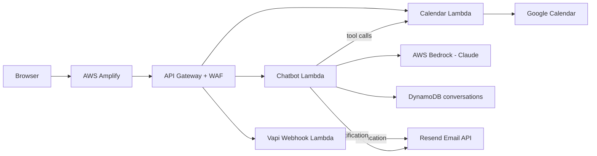

# Unkommon

Custom AI/ML engineering studio. Production-grade AI systems on AWS.


**Live:** [unkommon.ai](https://unkommon.ai)

## Architecture

```
Browser
  |
  |-- React SPA (AWS Amplify)
  |     |-- AI Chatbot with tool-calling
  |     +-- Calendar booking integration
  |
  +-- API Gateway (WAF rate-limited)
        |-- POST /api/chat ----------- Claude on Bedrock (tool-calling)
        |-- GET  /api/calendar/availability  Google Calendar API
        |-- POST /api/calendar/book ----------- Google Calendar API
        +-- POST /api/vapi-webhook --- HMAC-verified voice webhooks
```



## Features

**AI Chatbot.** Conversational assistant powered by Claude (Sonnet 4.5 / Haiku 4.5) on AWS Bedrock. Supports multi-turn conversations with DynamoDB persistence (24 hour TTL) and tool-calling for calendar availability checks and appointment booking. Includes server-side prompt injection detection and a global hourly request budget to cap Bedrock costs.

**Calendar Integration.** Google Calendar API with service account domain-wide delegation. Checks real-time availability, books appointments with conflict detection, generates Google Meet links, and sends branded HTML confirmation emails via Resend.

**Voice Webhook Processing.** Inbound voice call webhook handler with HMAC signature verification (fail-closed). Extracts structured data from Vapi call reports (name, email, phone) and triggers lead notification emails to the sales team via Resend.

## Tech Stack

| Frontend | Backend | Infrastructure |
|----------|---------|----------------|
| React 18 + TypeScript | Python 3.13 | AWS SAM (IaC) |
| Vite | AWS Lambda (3 functions) | API Gateway + WAFv2 |
| Tailwind CSS | AWS Bedrock (Claude) | DynamoDB (1 table) |
| Framer Motion | Google Calendar API | AWS Secrets Manager |
| Radix UI / shadcn | Resend (email) | AWS Amplify (hosting) |
| Wouter (routing) | boto3 / requests | |
| Three.js (globe) | | |

## Project Structure

```
.
├── frontend/                React SPA
│   ├── src/
│   │   ├── components/      UI components (ChatWidget, HeroBackground, etc.)
│   │   ├── pages/           Route pages (home, solutions, about, etc.)
│   │   ├── hooks/           Custom hooks
│   │   └── lib/             Utilities and config
│   ├── public/              Static assets
│   └── package.json
│
├── backend/                 AWS SAM serverless API
│   ├── chatbot/             AI chatbot (Bedrock + tool-calling)
│   │   ├── app.py           Request handler with injection detection
│   │   └── stream.py        SSE streaming handler
│   ├── calendar_api/        Google Calendar integration
│   ├── vapi_webhook/        Voice webhook processor (HMAC-verified)
│   ├── tests/               Test suite
│   ├── events/              Sample invocation events
│   └── template.yaml        SAM infrastructure definition
│
├── amplify.yml              Amplify build config + security headers
├── CLAUDE.md                AI assistant project context
└── LICENSE
```

## Getting Started

### Prerequisites

- Node.js 18+
- Python 3.13
- AWS SAM CLI
- AWS account with Bedrock access (Claude Sonnet 4.5 / Haiku 4.5 model access enabled)

### Frontend

```bash
cd frontend
cp .env.example .env       # Fill in your API URLs and keys
npm install
npm run dev                # Dev server on :3000
```

### Backend

```bash
cd backend
sam build
sam deploy --guided        # First deploy (creates resources + prompts for parameters)
```

Required SAM parameters: `VapiWebhookSecret`, `ResendApiKey`, `LeadsNotificationEmail`.

## Security

This project implements defense-in-depth:

- **Authentication.** HMAC signature verification on Vapi webhooks (fail-closed).
- **Rate limiting.** AWS WAFv2 per-IP rules (100 requests / 5 minutes global, 30 requests / 5 minutes on the chatbot endpoint), plus application-level booking rate limits and a global hourly request budget.
- **Injection defense.** Regex-based prompt injection detection before LLM invocation, server-side tool parameter validation independent of LLM output, and a hardened system prompt with anti-injection rules.
- **Input validation.** UUID format enforcement, email and date and phone regex validation, message length limits.
- **CORS.** Dynamic origin matching for production domains, not wildcard.
- **Headers.** HSTS, CSP, X-Frame-Options DENY, X-Content-Type-Options, Permissions-Policy, Referrer-Policy.
- **Secrets.** AWS Secrets Manager for Google Calendar credentials, SAM NoEcho parameters for runtime secrets, no hardcoded secrets in the repository.
- **Data.** DynamoDB parameterized queries, HTML escaping in email templates, 24 hour TTL on conversation data.

## Deployment

| Component | Platform | Trigger |
|-----------|----------|---------|
| Frontend | AWS Amplify | Git push to `main` |
| Backend | AWS SAM | `sam build && sam deploy` |
| WAF | AWS WAFv2 | Attached via CLI post-deploy |

## Roadmap

Planned additions for the next iteration:

- **Admin dashboard.** Cognito-authenticated leads management interface with JWT validation at the Lambda level. Will introduce a new `leads_api` Lambda and a Cognito User Pool.
- **Lead persistence.** New DynamoDB table for lead records, currently sent only by email. Will support querying by date and customer.
- **Appointment cache.** New DynamoDB table for booked appointments to avoid round-trips to Google Calendar for common reads.
- **Contact form endpoint.** New `contact_form` Lambda for direct contact submissions.
- **CI/CD pipeline.** GitHub Actions with OpenID Connect federation to AWS, replacing manual `sam deploy` runs.
- **Layered backend refactor.** Split each Lambda into API, service, and data access layers for testability.
- **Analytics layer.** DynamoDB Streams to S3 in Parquet format with Athena queries for trend analysis.

## License

MIT License. See [LICENSE](LICENSE).
